# OpenLink

**Your phone and your PC. Nothing in between.**

<p align="center">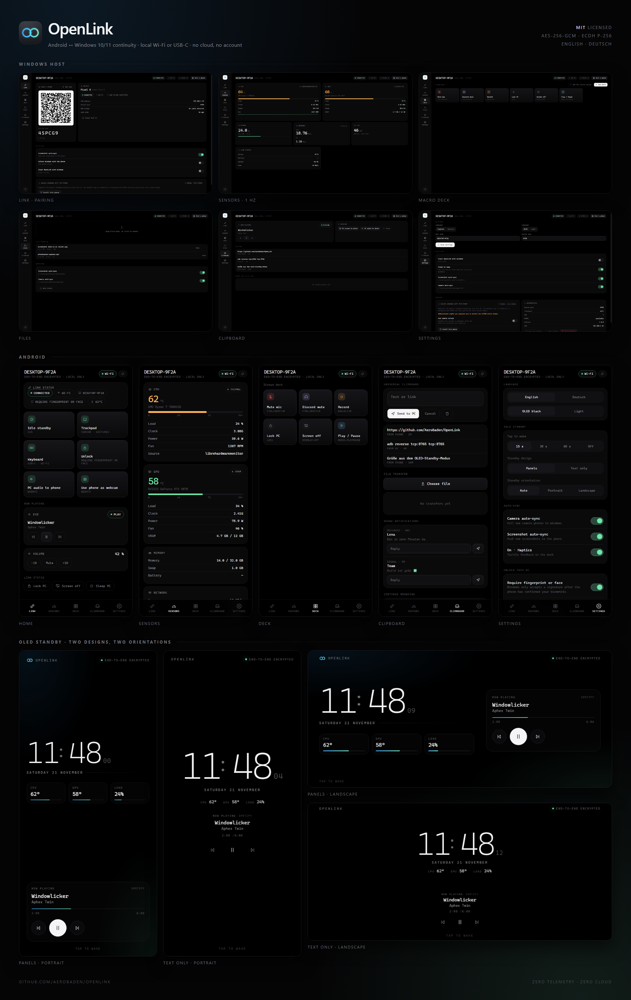</p>

OpenLink is an open-source, cross-device ecosystem for **Android** and **Windows 10/11** that replaces the useful parts of Microsoft Phone Link, Apple Continuity, Apple StandBy and hardware sensor panels — over your own Wi-Fi or a USB-C cable. No account, no cloud, no subscription, no telemetry. Ever.

```
  Android (Capacitor 6)                    Windows 10/11 (Electron)
  ┌────────────────────────┐   E2E        ┌────────────────────────────┐
  │ OLED standby clock     │◄────────────►│ Express + ws :8765         │
  │ MSI-style sensor deck  │  AES-256-GCM │ systeminformation + LHM    │
  │ Macro stream deck      │  over ECDH   │ GSMTCP media bridge        │
  │ Clipboard / files      │              │ adb reverse USB boost      │
  │ Biometric unlock       │◄── WebRTC ──►│ screen + loopback audio    │
  └────────────────────────┘              └────────────────────────────┘
                ▲                                       ▲
                └──────────── QR pairing ───────────────┘
```

| | |
|---|---|
| **License** | MIT |
| **Transport** | Local Wi-Fi (LAN) and USB-C via `adb reverse` |
| **Encryption** | Ephemeral P-256 ECDH → HKDF-SHA256 → AES-256-GCM per frame |
| **Artifacts** | `OpenLink-Android.apk`, `OpenLink-Windows.exe` |
| **Languages** | English and German, every screen |

---

## Screenshots

Dark mode, English, captured from the shipping UI components.

### Windows 10/11 host

| Link | Sensors | Deck |
|---|---|---|
| 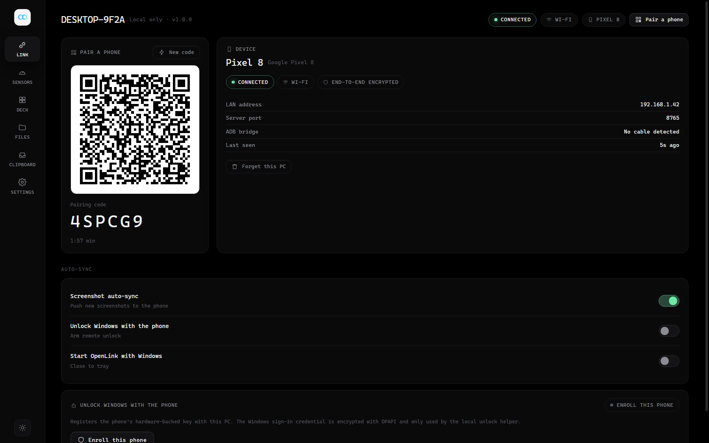 | 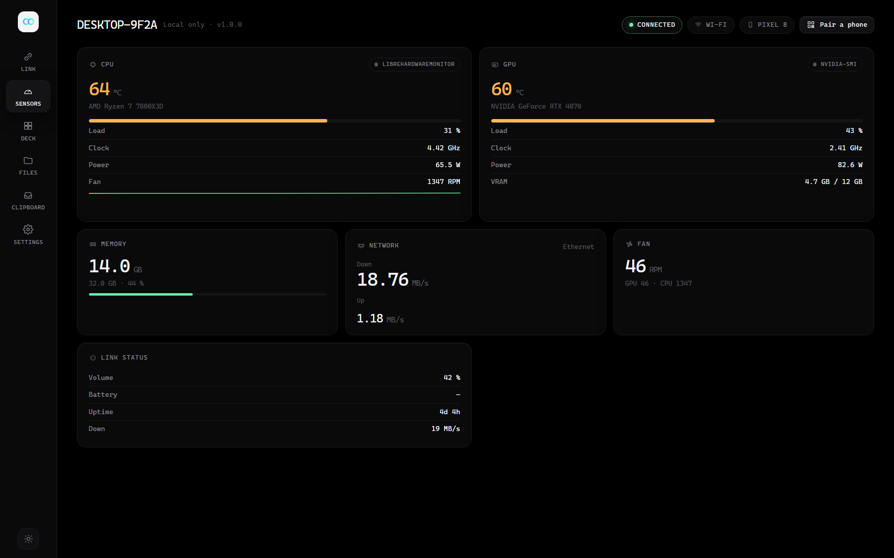 | 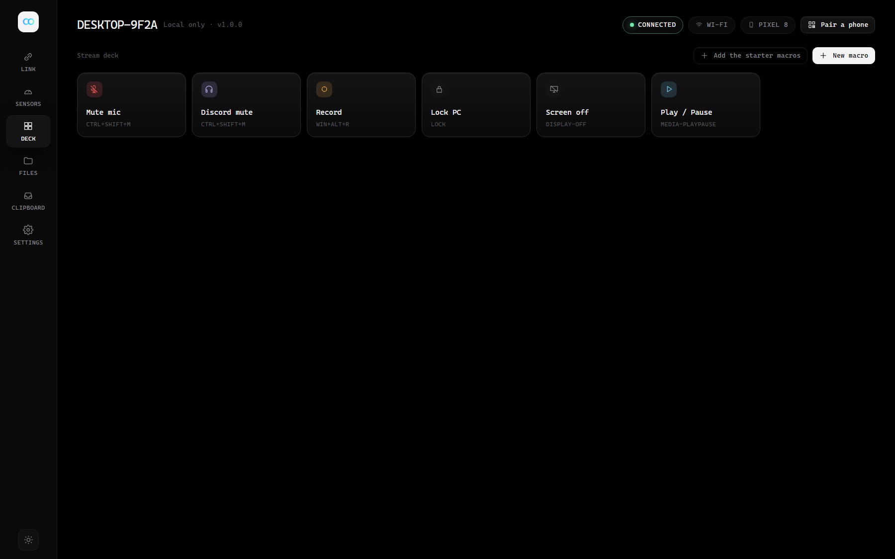 |
| **Files** | **Clipboard** | **Settings** |
| 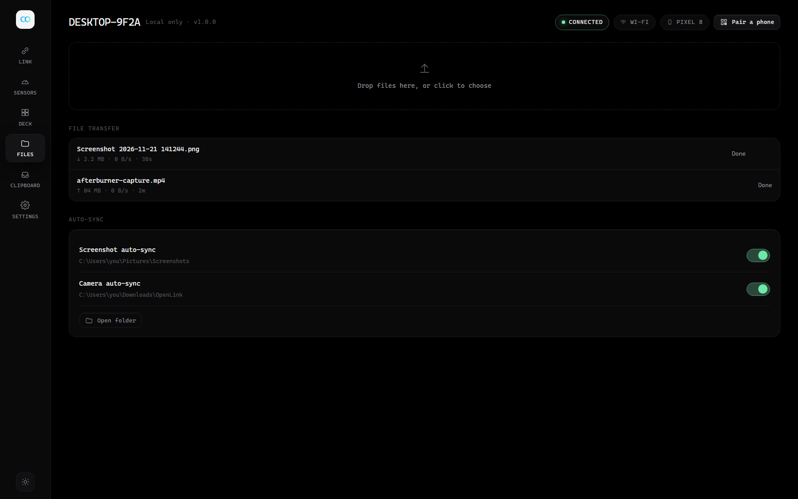 | 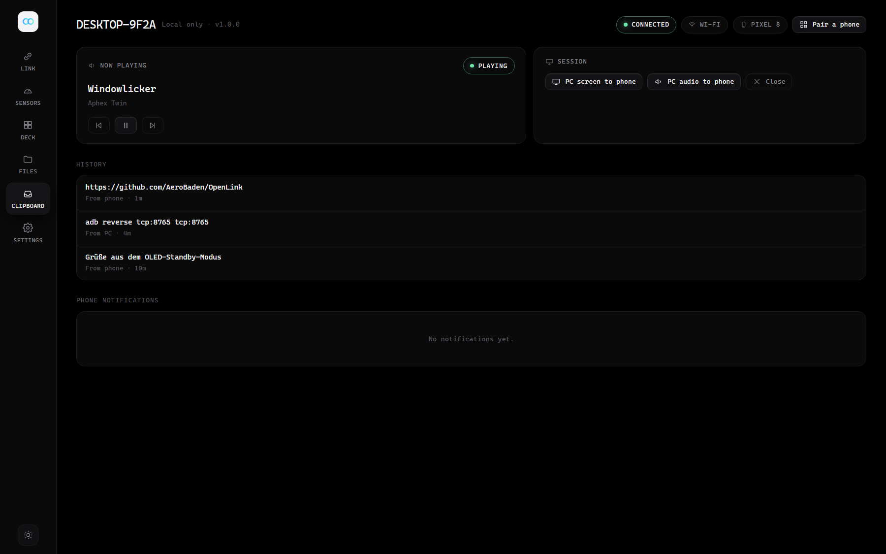 | 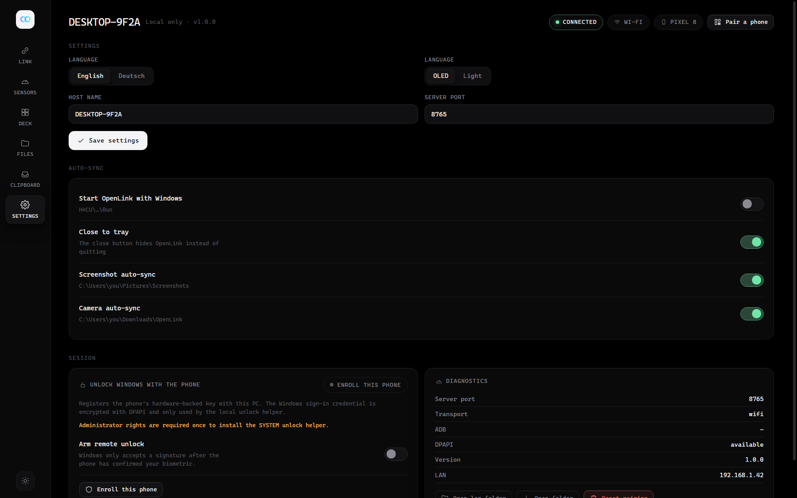 |

### Android

| Home | Sensors | Deck |
|---|---|---|
| 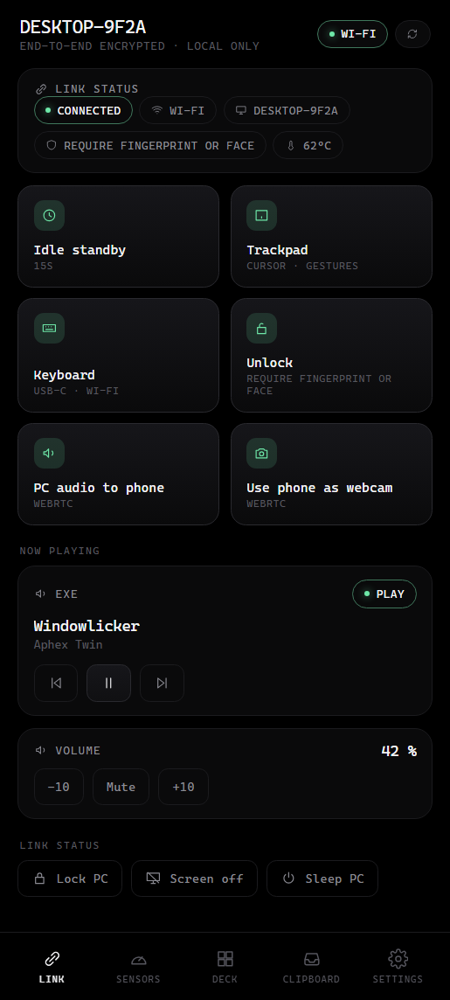 | 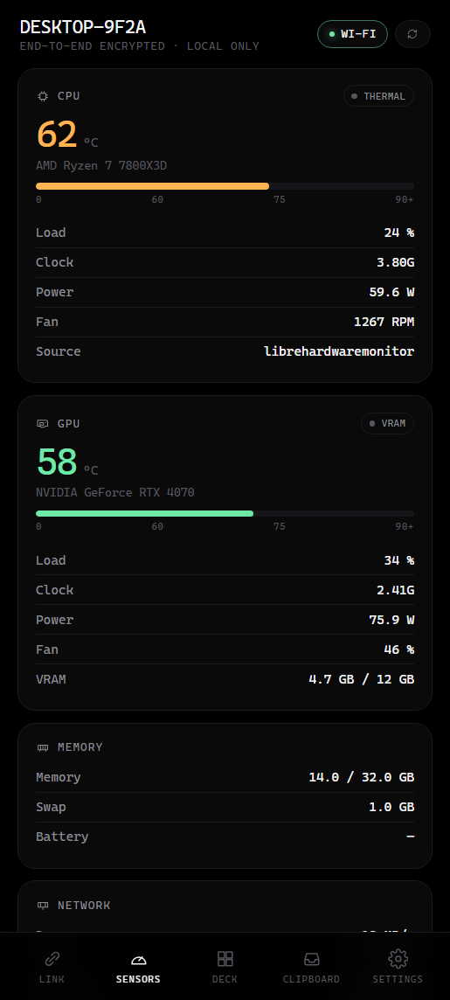 | 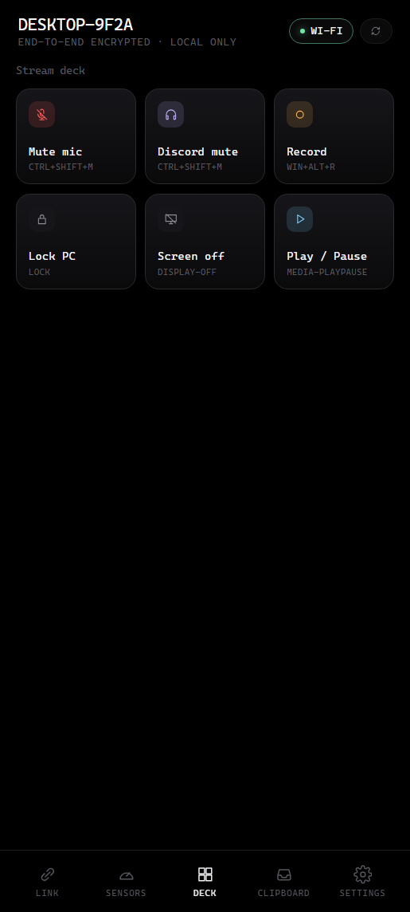 |
| **OLED standby** | **Clipboard** | **Settings** |
| 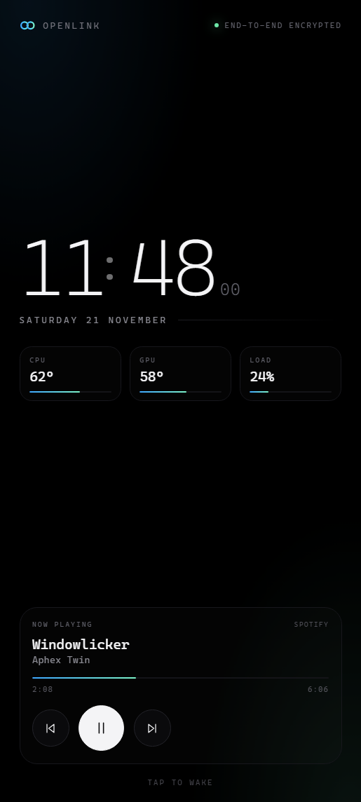 | 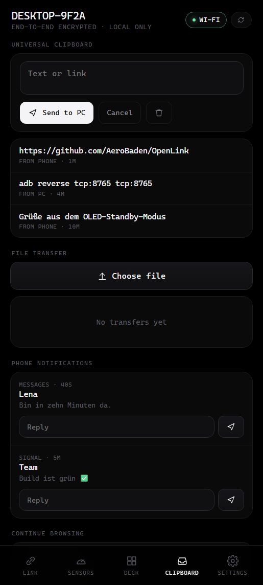 | 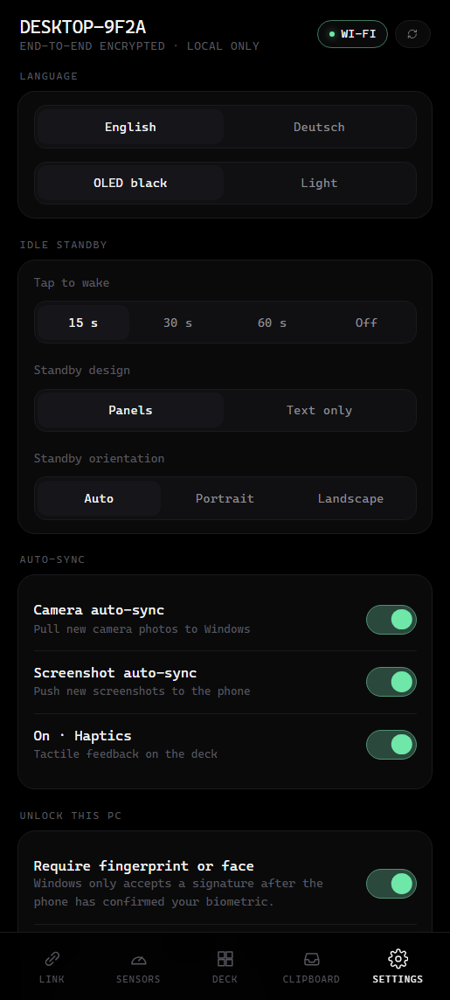 |

The standby face ships in **two designs** and **two compositions**, both selectable in Settings:

| Panels | Text only |
|---|---|
|  | 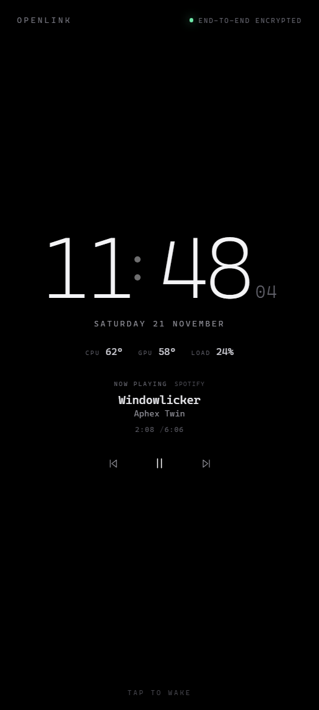 |

| Panels, landscape | Text only, landscape |
|---|---|
| 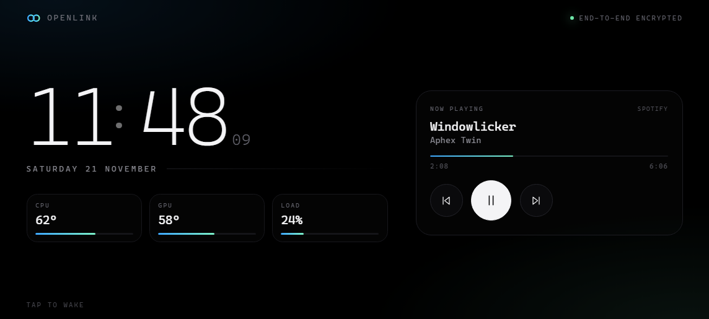 | 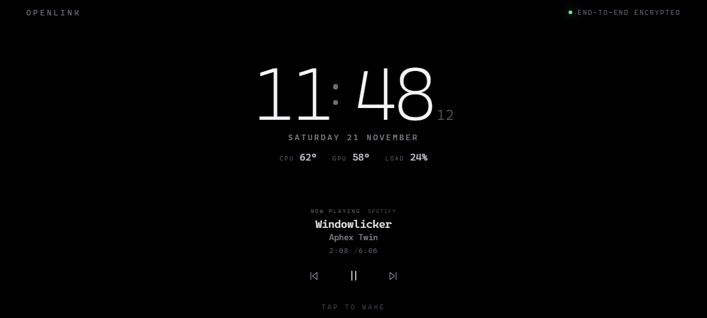 |

---

## What it does

### 1. Pairing that never leaves your network
The PC renders a QR code containing a 6-character one-time code (120 s TTL) and its LAN address. The phone scans it, both sides derive a session key and a six-character safety code you can visually compare. From then on every frame is sealed with AES-256-GCM using a per-connection ECDH key and a monotonic counter (replay-protected). Nothing is registered, nothing phones home.

Plug in a USB-C cable with USB debugging enabled and the host automatically runs

```
adb reverse tcp:8765 tcp:8765
```

so the phone's own `127.0.0.1:8765` tunnels to the PC with wired latency. The client prefers the wired path when it exists and falls back to Wi-Fi seamlessly.

### 2. Biometric PC unlock
The phone's identity key lives in the **Android Keystore** (TEE/StrongBox where available) and never leaves it. To unlock the PC:

1. The phone asks the host for a single-use 24-byte challenge (30 s TTL).
2. `BiometricPrompt` (fingerprint / face) must succeed before the key will sign.
3. The phone returns an ECDSA signature over `nonce:timestamp`.
4. The host verifies it against the enrolled device key, then runs the `OpenLinkUnlock` scheduled task, which duplicates the console session's `winlogon` token and types the DPAPI-protected credential onto the `WinSta0\Winlogon` desktop.

Windows does not expose a supported API for this, so the helper is a SYSTEM task and **enrollment needs administrator rights once**. The credential is stored machine-scope with DPAPI and an ACL restricted to SYSTEM/Administrators; it is never sent to the phone, and the phone never receives it. See [Security model](#security-model).

### 3. OLED desk standby clock
After 15 seconds idle (configurable, or immediately when the phone is rotated landscape while connected) the phone becomes a true `#000000` clock: tabular time, localized date, CPU/GPU temperatures, and the PC's now-playing track with play/pause/next. The whole block drifts on a 5-minute cycle to avoid burn-in, and the screen stays awake while the mode is active.

### 4. MSI Afterburner-style sensor deck
Every second the host streams CPU/GPU temperature, load, clock, package power, fan RPM, VRAM, RAM, network rates, volume and battery. Colour-coded thermal bars go green → amber → red.

Sources, in priority order, with honest reporting when a sensor is missing:

| Field | Primary | Fallback |
|---|---|---|
| CPU temperature | LibreHardwareMonitor WMI (`root\librehardwaremonitor`) | `systeminformation` |
| CPU package power / fan | LibreHardwareMonitor | — (reported as `—`) |
| GPU temp/load/clock/power/fan/VRAM | `nvidia-smi` | LibreHardwareMonitor, then `systeminformation` |
| RAM / network / battery / uptime | `systeminformation` | — |

Enable **Options → WMI provider** in LibreHardwareMonitor (run once as admin) to unlock the full deck. Without it you still get NVIDIA telemetry via `nvidia-smi` and CPU temperature via WMI.

### 5. Continuity suite
- **Universal clipboard** with a 20-item synced history, in both directions.
- **Browser tab handoff** — send a URL from the phone to open on the PC, or replay the last handed-off tab.
- **Screenshot auto-push** — new files in `Pictures\Screenshots` are offered to the phone automatically.
- **Camera auto-sync** — new MediaStore photos are pushed to Windows (opt-in, throttled, 6 MB per photo cap).
- **AirDrop-style file transfer** — drag and drop on Windows, or Android's share sheet; live MB/s progress in both UIs.
- **Macro stream deck** — tactile 3-column grid on the phone, macros defined on the PC: key combos (Mute Mic, Discord Mute, Start/Stop Recording), launch programs, open URLs, type text, set volume, lock/sleep/screen-off.
- **Wireless webcam and audio bridge** — WebRTC: PC screen + Windows loopback audio to the phone, phone camera back to the PC.
- **Trackpad, remote keyboard, notifications with quick reply** — including `RemoteInput` replies posted back to the original app.
- **Share target** — share any file, image, link or text from any Android app straight to OpenLink.

---

## Repository layout

```
desktop/                  Windows host (Electron 32 + Express + ws)
  src/main/               server, pairing, telemetry, media, input agent, files, adb, unlock
  src/preload/            contextBridge API (no Node in the renderer)
  src/renderer/           Tactile Minimalism UI + WebRTC cast controller
  resources/*.ps1         Windows helpers: input/audio agent, GSMTCP media, LHM, unlock
mobile/                   Android client (Capacitor 6 + Vite)
  src/                    link client, crypto, views (clock, sensors, deck, inbox…)
  android/                Gradle project, native plugin, QR scanner, notification relay
shared/                   protocol types and the English/German dictionary
scripts/make-icons.mjs    deterministic PNG/ICO generator (no image deps)
.github/workflows/        independent Windows and Android release pipelines
```

---

## Getting started

### Use a release
1. Install `OpenLink-Windows.exe`. Allow it through Windows Firewall for **private networks** (port 8765).
2. Optional but recommended: install LibreHardwareMonitor for the full sensor deck.
3. Install `OpenLink-Android.apk` (enable "install unknown apps" for your file manager).
4. On the PC open **Link → Pair a phone**, then on the phone tap **Scan QR code**.
5. Compare the six-character safety code and you're done.

USB-C boost: enable **Developer options → USB debugging** on the phone, plug in, accept the prompt. OpenLink detects the device within three seconds and applies `adb reverse` automatically.

### Build from source

Requirements: Node 20+, Android SDK 34 + JDK 17 for the APK, Windows (or wine) for the installer.

```bash
# Icons (deterministic, checked in)
node scripts/make-icons.mjs

# Windows host
cd desktop
npm ci
npm run typecheck
npm run build          # esbuild main + Vite renderer
npm start              # run unpackaged
npm run pack           # release/OpenLink-Windows.exe
```

```bash
# Android client
cd mobile
npm ci
npm run build          # typecheck + Vite → dist/
npx cap sync android
cd android && ./gradlew assembleRelease
# → app/build/outputs/apk/release/app-release.apk
```

### Release automation

Both workflows run independently and attach their artifact to the same GitHub Release on any `v*` tag.

| Workflow | Output | Notes |
|---|---|---|
| `build-windows.yml` | `OpenLink-Windows.exe` | NSIS installer, x64, icon generated in CI |
| `build-android.yml` | `OpenLink-Android.apk` | `assembleRelease`; debug-signed if no keystore secret |

Optional Android signing secrets:

```
ANDROID_KEYSTORE_BASE64      # base64 of your .jks
ANDROID_KEYSTORE_PASSWORD
ANDROID_KEY_ALIAS            # default: openlink
ANDROID_KEY_PASSWORD         # default: same as store password
```

Without them the release APK is signed with the debug key so CI still produces an installable artifact. Never commit a keystore.

---

## Security model

**What is protected**

- Pairing requires the QR code, which is only rendered on the host and expires after two minutes. The code is single-use.
- The Android identity key is generated inside the Android Keystore and is non-exportable. Only ECDSA signatures cross the bridge.
- Session keys come from an ephemeral ECDH exchange, are never stored, and are unique per connection. Frames are AES-256-GCM sealed with a 64-bit counter nonce; out-of-order or replayed frames are rejected.
- The host verifies the identity signature over `nonce:timestamp:ephemeralKey`, which binds the ephemeral key to the enrolled device.
- The Windows sign-in credential is DPAPI-protected (machine scope) and readable only by SYSTEM/Administrators. It is never transmitted.
- HTTP file endpoints require the paired device token; upload/download URLs are short-lived.
- The WebSocket server accepts one phone at a time and rate-limits failed authentications.

**What to know before enabling remote unlock**

- Windows has no public API to unlock the lock screen. OpenLink's helper duplicates the `winlogon` token and types the credential into the secure desktop. This is powerful by design: **only install it if you trust this machine and this code**, and review `desktop/resources/openlink-unlock*.ps1`.
- Machine-scope DPAPI means any local administrator of that machine could decrypt the blob. If that is unacceptable, keep remote unlock disabled and use Windows Hello.
- The phone enforces biometric confirmation before signing. The host cannot cryptographically prove that biometrics ran; it trusts the enrolled device, which is why the device key is hardware-bound.
- Enrollment installs a scheduled task named `OpenLinkUnlock` running as SYSTEM. Remove it with `schtasks /Delete /TN OpenLinkUnlock /F`.

**Network**

The server binds `0.0.0.0` so phones on the LAN can reach it. It does not use TLS on the wire — instead, all control traffic is end-to-end encrypted above the socket, and file bytes require the device token. Cleartext HTTP is needed for `ws://` on Android; restrict the PC to trusted networks.

---

## Design: Tactile Minimalism

- **Two palettes, no greys in between**: true OLED `#000000` with `#0A0A0B` panels, and light `#F4F4F6` with white panels. One accent per state (`#6EE7A8` / `#0F9D63`).
- **Hairline geometry**: 1 px borders, 9–16 px radii, no drop shadows except a single inset highlight so controls read as physical keys.
- **Tabular monospace everywhere** (`ui-monospace, Cascadia Mono, JetBrains Mono…`) with `font-variant-numeric: tabular-nums`, so numbers never jitter while telemetry ticks.
- **Restraint**: one accent per card, no decorative gradients except the key-press surface, motion limited to 90–380 ms.
- **Bilingual by construction**: every string goes through `shared/i18n.ts`; German labels for macros are optional per macro.

---

## Troubleshooting

| Symptom | Fix |
|---|---|
| Phone can't connect | Allow OpenLink through Windows Firewall on private networks; confirm `http://<pc-ip>:8765/health` answers from the phone |
| `adb not found` | Install platform-tools, or set `ADB_PATH`, or keep `adb` on `PATH` |
| Sensor values show `—` | Install and run LibreHardwareMonitor once as admin (WMI provider), and/or an NVIDIA driver for `nvidia-smi` |
| Unlock enrollment fails | Start OpenLink once **as administrator**, then enroll from Settings |
| Notification mirroring empty | Grant notification access: Android Settings → Notifications → Device & app notifications → OpenLink |
| Photos never sync | Grant photo permission when prompted; auto-sync runs every 5 minutes while connected |
| Virtual webcam not selectable in Teams/Zoom | The phone feed renders in OpenLink's session card; capture that window with OBS Virtual Camera (a kernel camera driver is out of scope) |
| Standby mode enters too fast | Settings → Idle standby → 30 s / 60 s / off |

Logs: `%APPDATA%\OpenLink\openlink.log`, clipboard history and settings in the same folder. Unlock helper log: `%ProgramData%\OpenLink\unlock.log`.

---

## Privacy

- Zero cloud accounts, zero analytics, zero crash reporting.
- Telemetry never leaves the two paired devices; the history ring buffers live in memory or in `userData`.
- The only network call the host makes is to `nvidia-smi`, a local binary.
- Uninstalling the Windows app leaves your data in place; delete `%APPDATA%\OpenLink` to remove it.

## Contributing

Issues and pull requests are welcome. Please keep the two ground rules: no cloud dependency may be introduced for a core feature, and every user-visible string must exist in both English and German.

## License

MIT — see [LICENSE](LICENSE). Not affiliated with Microsoft, Apple or MSI.
